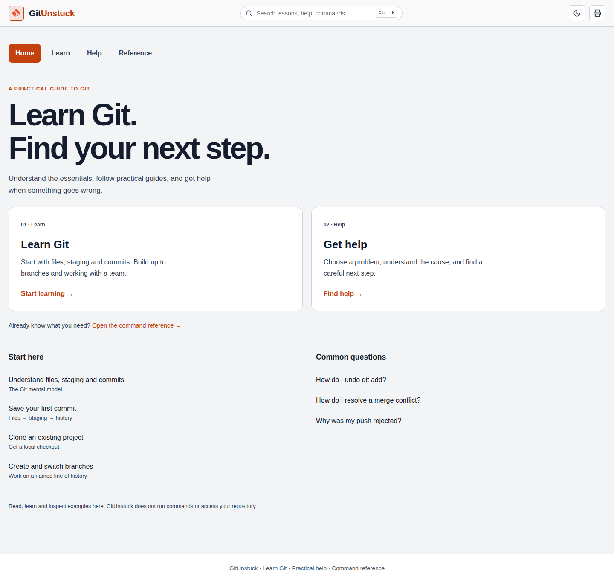

# Learning/help corrective acceptance

2026-10-13. User-directed corrective plan replaces feature expansion.

## Implemented

- Home defaults to learning/help, with no paste forms, host/shell controls or default repair.
- Four primary destinations: Home, Learn, Help, Reference. Old workflow/playground hashes map to learning and fixed illustrations.
- 17 unique task guides have a goal, real starting conditions, explanation, worked example, expected result and specific fallback. Initialization/cloning do not assume an existing repository.
- Eight readable help topics precede optional diagnostic tools. One visible recovery interface; legacy adapter stays hidden for compatibility tests.
- Canonical 24-command index, seven comparisons and grouped lesson/help/error/reference search. Existing reference filters still compose conjunctively.
- Global mode controls removed. Shell formatting belongs to Reference; provider selection explicitly scopes error interpretation.
- Corrected claims about file saves/commits, index snapshots, branches/worktrees, retained-commit recovery, detached HEAD and static illustrations. Static topic snippets match canonical knowledge.
- Shared textarea/component styles; no diagnostic inputs/results in default print; useful static examples without JavaScript.
- Read-only copy remains possible; parameterized/risky task examples do not get a blind compound-action copy button.

## Verification so far

Local: npm test 179 passed, 0 failed; npm run check, npm run build and git diff --check passed.

CI 38367585806 at 807df456e4d9c4cc6b4573c1c08ed8b063e6e1d4: source/Git/build and frozen baseline passed. New browser test inspected old help state before hash navigation finished; corrected the wait. Also corrected independently discovered search-focus loss.

CI 38367992092 at 6e06427239cdb5e2aac03fda8b4e00351e72b8c9: reference link target size failed axe. Increased link hit areas and made examples optional disclosures; accessibility assertion retained. The suite now records all accessibility states before evaluating its final unchanged serious/critical gate, helping diagnose multiple states together.

Desktop Home and first-commit screenshots from the first run were actually viewed. They confirmed a learning/help first visit and a readable task-specific lesson. Further adjustments reduced duplicate section headings and enlarged code text. Full final visual review remains pending.

## Required final checks

- Four viewport sizes (1440x900, 768x1024, 390x844, 320x568), both themes.
- Home, learning index, first commit, unstage help, gated action, error ambiguity, reference and command page.
- Both first-visit choices fit 390x844; no horizontal document overflow.
- Paste injection/no persistence, blocked prerequisites, literal placeholders, share-link privacy and failure return.
- Search across actual content types with aliases; category/effect conjunction; navigation/legacy hashes; theme persistence; read-only copy; no-JavaScript and print privacy.
- Actual screenshot inspection, reported separately from screenshot capture and axe.

Human screen-reader sessions and user design acceptance are not represented by automated checks. The fixed visual scenarios are not a simulator; hosted CLI/API authentication and CI templates are not claimed end-to-end verified.

## Publishing correction

Inspection found GitHub's automatic “pages build and deployment” workflow runs for v2.0 and has been publishing this branch. Earlier statements that branch pushes left the live site untouched were incorrect. Main is unchanged, but the separate auto-Pages flow is not held by the custom quality gate. This was disclosed during the work; verify the live output rather than assuming branch-only preview.

## Passed experience matrix

CI 38368312325 at a50ffcbe80d6c81192d832126a11a53712ff77ea passed: 179 source/Git tests, content/build checks, 8 frozen-baseline contexts, 8 new experience contexts (four widths x two themes), 64 accessibility state observations and no-JavaScript fallback. 49 rendered screenshots captured.

Actually viewed: desktop Home and first-commit lesson, 390px dark Home, 320px light unstage help, and desktop Reference. Mobile Home showed both main choices within 390x844; narrow help retained readable text and a keyboard-focusable horizontally scrollable code region. Reference inspection found the CI example remained outside its disclosure and stretched a whole row; moved it inside. Page metadata/FAQ descriptions now match learning/help. Residual Safe Sandbox tab label removed. CI examples specify Node 24/dependency installation and remain explicitly limited to test jobs; GitLab/Bitbucket provider lint/live execution is unclaimed. YAML is no longer transformed into CMD REM comments when the example shell changes.

Final source changes require their own CI confirmation; do not interpret the earlier passing SHA as proof of those later edits.

## Final verified source

CI 38370326359 at 9802e2f793d089870ba3a3db285676ae67064f08 passed all 179 source/Git tests, content/public-build checks, eight frozen-baseline contexts and eight experience contexts with 64 accessibility states plus no-JavaScript fallback. All 49 screenshots captured. CMD selection preserves CI YAML comments; the provider switch still displays the selected configuration.

Three CI examples were parsed locally with PyYAML BaseLoader; assertions verified test/dependency structure and GitHub read-only permissions. Official GitHub Node.js, GitLab YAML and Bitbucket Node.js documentation was consulted on 2026-10-13. These checks do not replace GitLab/Bitbucket provider lint or live runs.

The final desktop Home and mobile first-commit screenshots were viewed after the final run. Earlier representative mobile Home/help and Reference screenshots were also inspected; the CI panel/disclosure issue found during that inspection was corrected. Automated viewport coverage does not claim every image was individually reviewed.

Independent HTTP retrieval from https://dazzo31.github.io/gitunstuck/ confirmed the published learning/help title, Home markup and absence of Developer Hub/Safe Sandbox labels. Automatic Pages deployment published v2.0; main was not merged or edited.

### Saved previews

[Mobile Home](images/home-mobile.webp) · [Mobile first-commit lesson](images/first-commit-mobile.webp)

Source/editorial corrections and automated gates are complete for this corrective pass. Human screen-reader testing and user design acceptance remain open. No Git simulator, CI generator or local companion was added. The next work is specific feedback on this reviewable experience, rather than restarting the old feature queue automatically.
